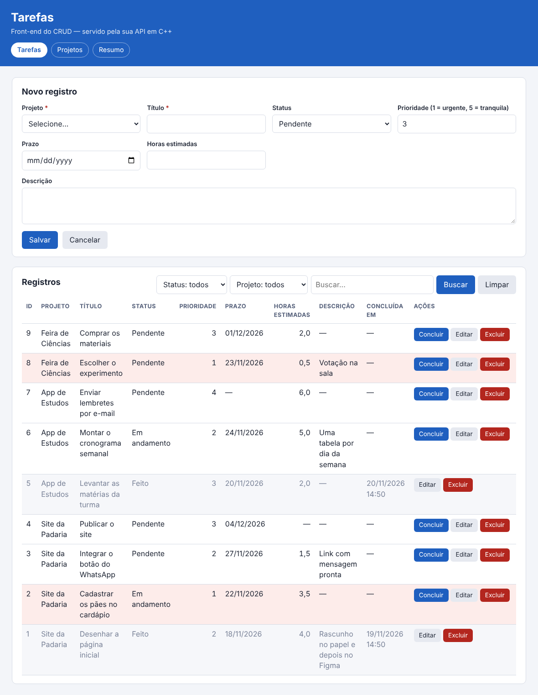
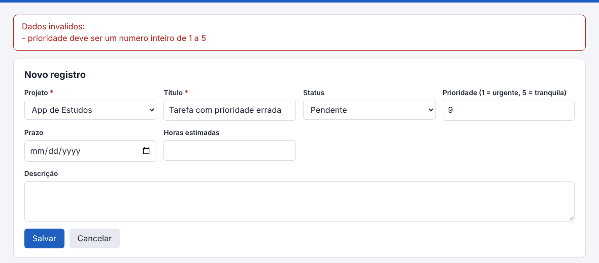
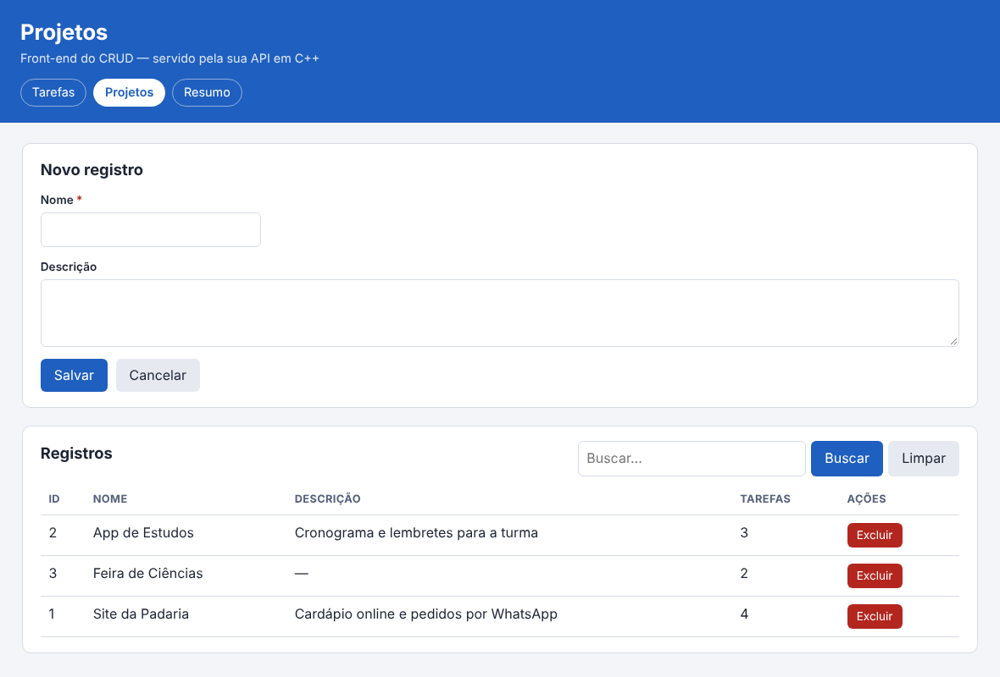
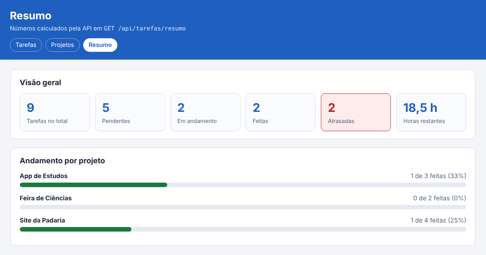

# Demo — Tarefas por Projeto

> **Este é o projeto-modelo do professor.** Ele tem a mesma forma que o projeto de vocês (uma entidade principal, uma de apoio, API em C++, MariaDB no Docker e front-end) e foi construído em passos, com uma *tag* do Git em cada um. Use-o de três jeitos: **rodar** para ver o resultado esperado, **ler o código** quando travar, e **copiar o formato deste README** para o README da sua equipe.
> Roteiro dos passos e das tags: [`ROTEIRO-LIVE-CODING.md`](ROTEIRO-LIVE-CODING.md). Exemplo de `EQUIPE.md` preenchido: [`EQUIPE.md`](EQUIPE.md).

Um sistema para uma turma acompanhar as **tarefas** de cada **projeto**: cadastrar projetos, cadastrar tarefas com prazo e prioridade, filtrar, concluir e ver um resumo do andamento.

```
Navegador (public/*.html + app.js)  ⇄  API em C++ (cpp-httplib + nlohmann/json)  ⇄  MariaDB (Docker)
```

## Telas

| Tarefas (lista, formulário, filtros e busca) | Erro de validação vindo da API |
|---|---|
|  |  |

| Projetos | Resumo |
|---|---|
|  |  |

Tarefas **atrasadas** (não concluídas e com prazo vencido) ficam em vermelho; tarefas **feitas** ficam apagadas e sem o botão *Concluir*.

## Como executar (do zero, em outro computador)

1. **Requisitos:** g++ com suporte a C++17 (MSYS2 UCRT64), biblioteca cliente do MariaDB (`libmariadb`) e Docker Desktop. Instalação detalhada: [`../guia/01-preparar-ambiente.md`](../guia/01-preparar-ambiente.md).
2. **Banco** (Docker Desktop aberto), na pasta `projetos/demo`:

   ```bash
   docker compose up -d --wait
   ```

   Cria o banco `projeto_iteam`, executa o `schema.sql` sozinho e insere dados de exemplo. Para **zerar** o banco e aplicar o `schema.sql` de novo (apaga os dados): `docker compose down -v` e depois `docker compose up -d --wait`.
3. **Compilar:** `./build.sh` (terminal do MSYS2 UCRT64) ou `build.bat` (`cmd`).
4. **Executar**, dentro da pasta `projetos/demo`: `./build/servidor.exe` (ou `./build.sh rodar`).
5. **Acessar:** <http://localhost:8080>

> Só um banco por vez usa a porta 3306. Se você subiu o banco do `starter-kit` ou de outra pasta, rode `docker compose down` lá antes. Outros problemas comuns: veja o [README do starter kit](../starter-kit/README.md#problemas-comuns).

## Rotas da API

| Método | Caminho | O que faz | Status possíveis |
|--------|---------|-----------|------------------|
| GET | `/api/saude` | servidor no ar | 200 |
| GET | `/api/saude/banco` | testa a conexão com o MariaDB | 200 · 500 |
| GET | `/api/projetos` | lista os projetos, cada um com `total_tarefas` | 200 |
| POST | `/api/projetos` | cria um projeto | 201 · 409 (nome repetido) · 422 |
| DELETE | `/api/projetos/:id` | remove um projeto | 204 · 404 · 409 (ainda tem tarefas) |
| GET | `/api/tarefas` | lista as tarefas; aceita `?busca=`, `?status=` e `?projeto_id=` (combinados) | 200 · 422 (filtro inválido) |
| GET | `/api/tarefas/resumo` | totais por status, atrasadas, horas restantes e andamento por projeto | 200 |
| GET | `/api/tarefas/:id` | uma tarefa | 200 · 400 · 404 |
| POST | `/api/tarefas` | cria uma tarefa | 201 · 400 · 422 |
| PUT | `/api/tarefas/:id` | atualiza (substitui todos os campos) | 200 · 400 · 404 · 422 |
| POST | `/api/tarefas/:id/concluir` | marca como `feito` e guarda a data/hora | 200 · 404 · 409 (já concluída) |
| DELETE | `/api/tarefas/:id` | remove uma tarefa | 204 · 404 |

Exemplos (no terminal do MSYS2/bash, com o servidor rodando):

```bash
# Criar uma tarefa: só projeto_id e titulo são obrigatórios
curl -X POST http://localhost:8080/api/tarefas \
  -d '{"projeto_id":1,"titulo":"Revisar o cardápio","prioridade":2,"prazo":"2026-12-10","horas_estimadas":1.5}'
# 201 {"id":10,"projeto_id":1,"projeto_nome":"Site da Padaria","titulo":"Revisar o cardápio","descricao":null,
#      "status":"pendente","prioridade":2,"prazo":"2026-12-10","horas_estimadas":1.5,"concluida_em":null,"criado_em":"..."}

# Dados inválidos: todos os problemas de uma vez
curl -X POST http://localhost:8080/api/tarefas -d '{"projeto_id":1,"titulo":"","prioridade":9}'
# 422 {"erro":"Dados invalidos","detalhes":["titulo e obrigatorio","prioridade deve ser um numero inteiro de 1 a 5"]}

# Filtros combinados (E): pendentes do projeto 1 que contenham "site"
curl "http://localhost:8080/api/tarefas?status=pendente&projeto_id=1&busca=site"

# Concluir (a segunda vez responde 409: a tarefa já está concluída)
curl -X POST http://localhost:8080/api/tarefas/3/concluir

# Resumo para o painel
curl http://localhost:8080/api/tarefas/resumo

# Projeto com tarefas não pode ser apagado
curl -X DELETE http://localhost:8080/api/projetos/1       # 409
```

No `cmd` e no PowerShell as aspas funcionam de outro jeito (e, no PowerShell, use `curl.exe`); prefira o terminal do MSYS2 ou a extensão *Thunder Client* do VS Code.

## Banco de dados

| Tabela | Colunas principais | Relacionamentos / regras |
|--------|--------------------|--------------------------|
| `projetos` | `id`, `nome`, `descricao`, `criado_em` | `nome` **obrigatório** e **único** (repetir → erro 1062 → API 409) |
| `tarefas` | `id`, `projeto_id`, `titulo`, `descricao`, `status`, `prioridade`, `prazo`, `horas_estimadas`, `concluida_em`, `criado_em` | `projeto_id` → `projetos.id` (**FK, `ON DELETE RESTRICT`**); `CHECK` em `status` (`pendente`/`andamento`/`feito`), `prioridade` (1 a 5) e `horas_estimadas` (≥ 0); `prazo`, `horas_estimadas` e `descricao` opcionais (gravam `NULL` de verdade) |

```
projetos (1) ───────< (N) tarefas
```

## Estrutura do código

```
demo/
├── docker-compose.yml, schema.sql      banco em container + tabelas e dados de exemplo
├── build.sh, build.bat                 compilação (no build.bat, novos .cpp entram na lista FONTES)
├── src/
│   ├── main.cpp                        liga tudo: rotas, arquivos estáticos, tratamento de erros
│   ├── banco.*, config.hpp, http_util.hpp   infraestrutura do starter kit (não mudou)
│   ├── parametros.hpp                  conversões dos valores que vão nos "?" do SQL
│   ├── validacao.hpp                   funções reutilizáveis de validação (texto, faixa, lista, data...)
│   ├── projeto_repositorio.*           TODO o SQL de "projetos"
│   ├── tarefa_repositorio.*            TODO o SQL de "tarefas" (JOIN, filtros dinâmicos, resumo)
│   └── rotas_projetos.*, rotas_tarefas.*   rotas HTTP + validação
└── public/
    ├── index.html + config.js          tela de Tarefas (o app.js monta tudo a partir do config.js)
    ├── projetos.html + config-projetos.js   tela de Projetos (mesmo app.js, outra configuração)
    └── resumo.html + resumo.js         página própria que consome /api/tarefas/resumo
```

## Decisões de projeto

- **Todo o SQL fica nos repositórios**; as rotas só validam a entrada e traduzem o resultado em status HTTP. Assim dá para trocar uma consulta sem mexer nas rotas.
- **Duas camadas de proteção:** a API valida (mensagens claras, 422) **e** o banco tem `NOT NULL`, `UNIQUE`, `FK` e `CHECK`. Se algo escapar da API, o banco ainda recusa, e o `comBanco` traduz o erro para 409/422.
- **`projeto_id` inexistente é conferido antes de gravar** (resposta 422 "projeto_id nao existe"), em vez de deixar o banco recusar com um 409 genérico.
- **Campos opcionais** usam `NULLIF(?, '')` no SQL: o front pode mandar vazio e o banco guarda `NULL`.
- **"Concluir" é uma rota de ação** (`POST /api/tarefas/:id/concluir`), não um `PUT` com todos os campos: o servidor decide a data de conclusão, não o navegador.
- **`/api/tarefas/resumo` é registrada antes de `/api/tarefas/:id`.** O httplib testa as rotas na ordem de registro; com a ordem trocada, o `:id` receberia a palavra "resumo" e a resposta seria 400 "Id invalido".

## Extras implementados

- [x] Busca (no título, na descrição e no nome do projeto) e filtros por status e projeto
- [x] Rota de resumo + página de resumo
- [x] Validações no front-end (campo obrigatório) além das da API
- [x] Destaque visual de tarefas atrasadas e botão *Concluir*
- [ ] Paginação ou ordenação (de propósito, ficou de fora: é um bom desafio para a sua equipe)

## Créditos das bibliotecas

[cpp-httplib](https://github.com/yhirose/cpp-httplib) (licença MIT) e [nlohmann/json](https://github.com/nlohmann/json) (licença MIT). Os textos das licenças estão em `libs/`.
